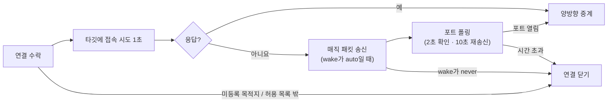

# wolproxy

`wolproxy`는 24/7 홈서버(Debian Linux / ARM64 등)에서 실행되는 **투명 TCP Wake-on-LAN 프록시 데몬 및 대화형 TUI 설정 편집기**입니다.

WireGuard VPN 등 신뢰된 유입 인터페이스로 들어오는 TCP 연결 중 프로파일에 등록된 포트를 `nftables`로 가로채 LAN의 타깃 PC로 중계하며, 타깃이 잠들어 있으면 자동으로 매직 패킷(WoL)을 보내 깨운 뒤 연결을 이어 줍니다.

---

## 주요 특징

- **투명 TCP 가로채기 (`nftables` + `SO_ORIGINAL_DST`)**
  - 클라이언트는 프록시 주소가 아닌 **타깃 PC의 실제 IP(또는 별칭 IP)**로 그대로 접속합니다.
  - 홈서버의 `ip_forward`나 기본 `forward` 체인을 건드리지 않고, 전용 `table inet wolproxy`만으로 지정된 `(타깃 IP·별칭, 프로파일 포트)`만 가로챕니다.
  - 데몬 시작 시 단일 트랜잭션(`nft -f -`)으로 규칙을 설치하고, 종료(`SIGTERM`) 시 깔끔하게 정리합니다.
- **자동 깨우기 및 중복 송신 합치기 (`singleflight`)**
  - 연결 수락 후 먼저 1초 타임아웃으로 타깃 접속을 시도하고, 응답이 없을 때만(`wake: auto`) 서브넷 브로드캐스트 UDP 9번으로 매직 패킷을 보냅니다.
  - 포트가 열릴 때까지 `poll_interval`(기본 2초)마다 확인하고 `wake_cooldown`(기본 10초)마다 재송신합니다.
  - 같은 타깃에 여러 연결이 동시에 들어와도 깨우기 작업은 하나로 합쳐 진행하며, 대기 중 클라이언트가 연결을 끊으면 즉시 중단합니다.
- **별칭(Alias) IP 지원**
  - 클라이언트 로컬 네트워크 대역과 집 LAN 대역이 겹칠 때 홈서버에 별도 주소를 추가하지 않고도 별칭 IP로 가로채 실제 타깃 IP로 중계합니다.
- **고성능 스트림 중계 및 유휴 연결 정리**
  - Linux `splice(2)` 경로를 활용하는 `io.Copy` 양방향 중계, TCP Keep-Alive, `CloseWrite` 기반 half-close 전달을 지원합니다.
  - 프로파일별 `idle_timeout` / `idle_bytes` 정책으로 유휴 연결을 자동 종료할 수 있습니다.
- **기본 거부(Default-Deny) 접근 제어와 무중단 재적재 (`SIGHUP`)**
  - 타깃마다 허용된 클라이언트(`allow`, IP/CIDR)만 접속할 수 있으며, 허용 목록 밖 출발지는 매직 패킷을 보내지 않고 즉시 닫습니다.
  - `systemctl reload wolproxy`(`SIGHUP`) 시 규칙을 빈틈 없이 교체하고, 유효한 기존 연결은 유지하되 권한이 회수되거나 삭제된 타깃·프로파일의 연결만 즉시 종료합니다.
- **내장 TUI 설정 편집기 (Bubble Tea + Huh)**
  - `sudo wolproxy` 실행만으로 타깃·클라이언트·프로파일·전역 설정 편집, LAN ARP 기기 검색(`Ctrl+L`), MAC 자동 채우기, 검증 오류 위치 점프, 백업(`.bak`) 및 서비스 적용까지 한 번에 처리합니다.
- **최소 권한 실행**
  - 전용 시스템 사용자 `wolproxy`와 `CAP_NET_ADMIN`, `CAP_NET_BIND_SERVICE` 권한만으로 데몬이 동작하며, `wolproxy wake`는 일반 사용자 권한으로도 동작합니다.

---

## 동작 흐름


### 연결 처리 단계



---

## 설치 및 빌드

### 요구사항

- **운영체제**: Linux (Debian 12+ 권장, `arm64` / `amd64`), IPv4 전용
- **런타임 패키지**: `nftables`, `systemd`, `adduser` (유입 망으로 `wireguard-tools` 권장)
- **빌드 환경**: Go 1.22 이상 (`CGO_ENABLED=0` 순수 Go 정적 바이너리)

### `.deb` 패키지 빌드 및 설치 (Debian ARM64)

저장소에 포함된 순수 Go 패키저(`cmd/build-deb`)를 사용하면 Linux·macOS·Windows 어디서든 `dpkg-deb` 없이 바로 Debian 패키지를 생성할 수 있습니다.

```bash
# wolproxy_0.1.0_arm64.deb 생성 (기본 출력 경로: dist/)
go run ./cmd/build-deb -version 0.1.0 -arch arm64 -out dist
# 또는 Makefile 사용:
make deb VERSION=0.1.0 ARCH=arm64
```

홈서버에서 패키지 설치:

```bash
sudo apt install ./wolproxy_0.1.0_arm64.deb
```

패키지 설치 구성:

| 경로 | 설명 |
| --- | --- |
| `/usr/bin/wolproxy` | 데몬·TUI·CLI 통합 실행 바이너리 |
| `/etc/wolproxy/config.yaml` | 설정 파일 (`conffile`로 지정되어 패키지 업그레이드 시 보존) |
| `/lib/systemd/system/wolproxy.service` | 전용 사용자(`wolproxy`) 기반 systemd 서비스 유닛 |

### 소스에서 직접 바이너리 빌드

```bash
# 현재 플랫폼용 빌드
CGO_ENABLED=0 go build -trimpath -o wolproxy ./cmd/wolproxy

# Linux ARM64 크로스 빌드
CGO_ENABLED=0 GOOS=linux GOARCH=arm64 go build -trimpath -o wolproxy-linux-arm64 ./cmd/wolproxy
```

---

## 네트워크 및 클라이언트 구성

1. **타깃 PC 준비**
   - 메인보드 BIOS/UEFI 및 OS 네트워크 어댑터 설정에서 **Wake on Magic Packet**을 활성화합니다.
   - 주의: NIC의 **ARP 오프로드(ARP Offload)**가 켜져 있으면 잠든 상태에서도 대리 ARP 응답을 보내 TUI 상태 표시나 프로파일 없는 타깃의 깨어남 판단에서 깨어 있는 것으로 보일 수 있습니다.
2. **VPN 클라이언트 경로 설정 (WireGuard 예시)**
   - 홈서버 전체 LAN 대역을 라우팅하지 않아도 타깃 `/32`(및 필요한 경우 별칭 `/32`)만 `AllowedIPs`에 넣으면 동작합니다.
   ```ini
   [Peer]
   # 홈서버 WireGuard 피어
   AllowedIPs = 10.66.0.1/32, 192.168.0.21/32, 192.168.0.22/32, 10.66.1.12/32
   ```
   - TLS·RDP 인증서 경고를 피하기 위해 호스트 이름으로 접속하려면 클라이언트 측 `hosts` 파일에 타깃 IP(또는 별칭 IP)와 컴퓨터 이름을 등록하세요.

---

## 설정 파일 (`/etc/wolproxy/config.yaml`)

설정 파일은 단일 YAML 파일이며, TUI 저장 시 주석은 보존되지 않으므로 각 항목의 메모는 선택 필드 `note`에 작성합니다.

```yaml
# 이 파일은 wolproxy TUI가 관리한다. 주석은 저장 시 사라지므로 메모는 note에 쓴다.
lan_interface: eth0
ingress_interfaces: [wg0]
proxy_port: 13389
wake_timeout: 120s
wake_cooldown: 10s
poll_interval: 2s

clients:
  laptop: { cidr: 10.66.0.2/32, note: "업무용 노트북" }
  phone: { cidr: 10.66.0.3/32 }

profiles:
  rdp: { port: 3389, wake: auto }
  ssh: { port: 22, wake: auto }
  ssh-manual: { port: 22, wake: never, note: "깨우지 않는 SSH" }
  ssh-short: { port: 2222, wake: auto, idle_timeout: 30m, idle_bytes: 1024 }

targets:
  - name: pc1
    note: "거실 데스크톱"
    ip: 192.168.0.21
    mac: "aa:bb:cc:dd:ee:01"
    profiles: [rdp, ssh-manual]
    allow: [laptop, phone]
  - name: pc2
    ip: 192.168.0.22
    alias: 10.66.1.12
    mac: "aa:bb:cc:dd:ee:02"
    profiles: [ssh]
    allow: [laptop]
```

### 주요 설정 항목

- **전역 설정**
  - `lan_interface`: 타깃 PC가 연결된 LAN 인터페이스 (서브넷 브로드캐스트 계산 및 ARP 조회에 사용)
  - `ingress_interfaces`: 연결을 가로챌 유입 인터페이스 목록 (예: `[wg0]`). 각 인터페이스의 IPv4 주소에 `IP_FREEBIND`로 `proxy_port`를 바인드합니다.
  - `proxy_port`: `nftables` 리다이렉트를 수신할 로컬 포트 (기본 `13389`)
  - `wake_timeout` / `wake_cooldown` / `poll_interval`: 깨우기 최대 대기 시간(기본 `120s`), 매직 패킷 재송신 주기(기본 `10s`), 포트 열림 확인 주기(기본 `2s`)
- **`clients`**: 접속을 허용할 클라이언트 이름과 IPv4 주소/CIDR
- **`profiles`**: 포트와 정책 묶음 (내장 프리셋: `rdp` `3389/auto`, `ssh` `22/auto`)
  - `wake`: `auto`(미응답 시 깨움) 또는 `never`(깨어 있을 때만 중계)
  - `idle_timeout` / `idle_bytes` (선택, 기본 `0`): `idle_timeout` 동안 양방향 합산 전송량이 `idle_bytes` 이하이면 연결 종료
- **`targets`**: 관리할 타깃 PC 목록 (`name`, `ip`, 선택 `alias`, `mac`, `profiles`, `allow`, 선택 `note`)
  - 깨울 필요가 없는 서비스(예: SMB)는 프로파일 없이 두고 필요할 때 `wolproxy wake`로 깨워 사용할 수 있습니다.

### 검증 항목

데몬 시작, `wolproxy check`, TUI 저장 시 모두 동일한 검증기를 실행합니다.

- 존재하지 않거나 IPv4가 없는 `lan_interface` / `ingress_interfaces`
- 중복된 타깃 이름·IP·별칭, 또는 LAN 인터페이스 서브넷과 겹치는 `alias`
- 잘못된 IPv4/CIDR, 유효하지 않은 6바이트 MAC 주소, 포트 범위(`1~65535`) 이탈
- 존재하지 않는 클라이언트·프로파일 참조, 한 타깃 내 동일 포트를 쓰는 복수 프로파일 지정

---

## CLI 및 TUI 사용법

### CLI 명령어

모든 명령에 `-c <경로>` 옵션으로 설정 파일 경로를 지정할 수 있습니다(기본값: `/etc/wolproxy/config.yaml`).

| 명령 | 설명 |
| --- | --- |
| `sudo wolproxy` | 대화형 TUI 설정 편집기 실행 (`root`가 아니면 읽기 전용으로 열림, 표준 입력이 TTY가 아니면 도움말 출력 후 비정상 종료 코드 반환) |
| `wolproxy serve` | 프록시 데몬 실행 (`systemd` 서비스 전용) |
| `wolproxy wake <타깃>... [--wait]` | 지정한 타깃에 매직 패킷 송신. `--wait` 지정 시 프로파일 포트(프로파일이 없으면 ARP 응답)가 열릴 때까지 `wake_timeout` 동안 대기 |
| `wolproxy check` | 설정 파일 유효성 검증 (정상 `0`, 오류 `0` 아님) |

### TUI 화면 및 단축키

상단 4개 탭(**1. 타깃**, **2. 클라이언트**, **3. 프로파일**, **4. 전역 설정**)으로 구성되며, 하단 상태바에 현재 화면에서 사용할 수 있는 단축키가 표시됩니다.

| 키 | 동작 | 위치 |
| --- | --- | --- |
| `Tab` / `Shift+Tab` | 다음·이전 탭 이동 (폼에서는 다음·이전 필드 이동) | 전체 |
| `↑` `↓` / `j` `k` | 항목 이동 | 목록 / 선택 창 |
| `Enter` | 편집 폼 열기 / 항목 선택 | 목록 / 선택 창 |
| `a` | 항목 추가 (프로파일 추가 시 `rdp`, `ssh`, 빈 프로파일 프리셋 선택) | 목록 |
| `d` | 항목 삭제 (타깃이 참조 중인 클라이언트·프로파일은 삭제 차단 및 참조 타깃 안내) | 목록 |
| `w` | 선택한 타깃에 즉시 매직 패킷 송신 (`깨우는 중` 표시) | 타깃 목록 |
| `t` | 선택한 타깃의 프로파일 TCP 포트 열림 테스트 | 타깃 목록 |
| `Ctrl+L` | LAN 서브넷(`/22` 이하) ARP 스캔으로 켜진 기기 IP·MAC·호스트명 검색 (`root` 전용) | 타깃 폼 |
| `Esc` | 폼 편집 취소(변경 버림) 또는 대화상자 닫기 | 폼 / 대화상자 |
| `s` / `Ctrl+S` | 검증 → 변경 요약 확인 → 백업(`.bak`)·원자적 저장 → `systemctl reload/restart` 적용 | 전체 |
| `?` | 도움말 열기/닫기 | 전체 |
| `q` | 종료 (저장하지 않은 변경이 있으면 확인) | 전체 |

---

## 운영 및 문제 해결

```bash
# 서비스 상태 및 실시간 로그 확인
sudo systemctl status wolproxy
sudo journalctl -u wolproxy -f

# 설정 수동 편집 후 검증 및 무중단 재적재 (SIGHUP)
sudo wolproxy check
sudo systemctl reload wolproxy

# lan_interface, ingress_interfaces, proxy_port 변경 시 재시작
sudo systemctl restart wolproxy

# 현재 적용된 nftables 가로채기 규칙 확인
sudo nft list table inet wolproxy
```

---

## 프로젝트 구조 및 테스트

```text
.
├── cmd/
│   ├── wolproxy/       # CLI 진입점 (TUI, serve, wake, check)
│   └── build-deb/      # 순수 Go Debian (.deb) 패키지 빌더
├── internal/
│   ├── arp/            # Linux AF_PACKET raw ARP 스캔 및 Netlink 이웃 테이블 조회
│   ├── config/         # YAML 파싱/직렬화, 주석 감지, 검증, 변경 요약(Diff), 원자적 저장
│   ├── netutil/        # 네트워크 인터페이스 추상화, IPv4/CIDR/브로드캐스트/MAC 유틸리티
│   ├── nft/            # table inet wolproxy 생성 및 nft -f - 트랜잭션 적용/정리
│   ├── proxy/          # IP_FREEBIND 리스너, SO_ORIGINAL_DST, 접근 제어, 깨우기 연동, 양방향 중계
│   ├── tui/            # Bubble Tea + Huh 기반 4탭 설정 편집기 및 systemd 연동
│   └── wol/            # 매직 패킷 생성/UDP 송신 및 타깃별 singleflight 깨우기 코디네이터
└── packaging/          # systemd 유닛, 기본 config.yaml, Debian 패키지 스크립트
```

단위 및 통합 테스트 실행:

```bash
go test -v ./...
```

---

## 라이선스

[MIT License](LICENSE)
