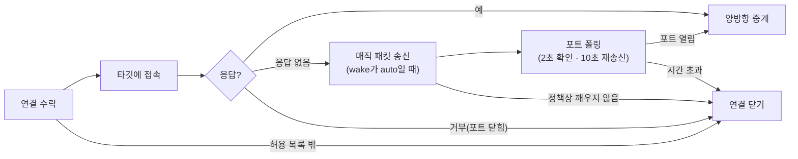

# TCP WoL 프록시 기능 명세

작성일: 2026-11-24 · 수정: 2026-11-25

## 개요

`wolproxy`는 24/7 홈서버에서 도는 Go 데몬이다. 신뢰된 유입 인터페이스(VPN 등)로 들어온 TCP 연결 중 프로파일에 등록된 포트를 가로채 LAN의 타깃 PC로 넘기고, 타깃이 잠들어 있으면 WoL로 깨운 뒤 연결한다.

- 흐름: 외부 PC → VPN(기본 WireGuard) → 홈서버(`wolproxy`) → 타깃 PC
- 환경: Cortex-A53 쿼드코어 1.4GHz, 데비안 aarch64, systemd 서비스(.deb)
- 그 외 트래픽: 가로채지 않는 TCP와 UDP는 시스템 라우팅·방화벽이 처리한다. 데몬은 `ip_forward`와 forward 체인을 건드리지 않는다.
- 비목표: TLS 종단과 L7 게이트웨이, 웹 UI, 이름 해석(DNS), WAN 직접 노출, IPv6(IPv4만 지원)

## 주소와 가로채기

클라이언트는 타깃의 실제 IP로 접속하고, 홈서버가 nftables로 그 연결을 가로채 프록시로 넘긴다. 유입 인터페이스는 출발지가 인증된 라우팅 망(VPN 등)을 전제로 한다. 인증되지 않은 망을 넣으면 출발지 IP는 기기를 구분할 뿐 인증이 아니다.

- 가로채기: 유입 인터페이스로 들어와 목적지가 `(타깃 IP·별칭, 프로파일 포트)`인 TCP만 프록시로 보낸다. 프록시는 각 유입 인터페이스의 `proxy_port`에서 받는다.
- 별칭(선택): 실제 IP가 클라이언트 쪽 네트워크와 겹칠 때만 쓴다. 같은 방식으로 가로채므로 홈서버에 주소를 만들지 않는다.
- 클라이언트 경로: 타깃 /32(와 별칭)만 VPN으로 보낸다(WG는 AllowedIPs).
- 업스트림: 홈서버 LAN IP에서 접속하므로 타깃에는 LAN 출발지로 보인다.
- 가로채기 규칙은 데몬이 시작할 때 만들고, 멈추거나 비정상 종료해도 남지 않는다.

## 연결 처리 흐름

연결이 오면 먼저 타깃에 붙어 보고, 응답이 없을 때만 매직 패킷을 보낸 뒤 포트가 열릴 때까지 클라이언트를 붙잡아 둔다.



1. 수락: 원래 목적지로 타깃을 찾는다. 모르는 목적지이거나 허용 목록 밖 출발지면 즉시 닫는다.
2. 접속 시도: 타깃 포트에 1초 타임아웃으로 접속한다. 거부되면(타깃은 켜져 있고 포트가 닫힘) 깨우지 않고 바로 닫는다.
3. 중계: 성공하면 양방향으로 중계하고, 한쪽이 닫으면 반대쪽에도 전달한다.
4. 깨우기: 응답이 없고(타임아웃·도달 불가) 프로파일의 `wake`가 `auto`면 매직 패킷을 보낸다. 기다리는 동안 `wake_cooldown`(기본 10초)마다 다시 보낸다.
5. 대기: `poll_interval`(기본 2초)마다 다시 접속해 보고, `wake_timeout`(기본 120초)이 지나면 닫는다. 기다리는 중 클라이언트가 끊으면 바로 중단한다.

같은 타깃에 동시 연결이 여러 개 와도 깨우기는 하나만 진행하고, 모두 그 결과를 기다린다. 대기 시간은 깨우기를 시작한 때부터 센다.

## 프로파일

프로파일은 포트와 정책의 묶음이다. 타깃은 프로파일 이름만 참조하고, 정책이 다르면 프로파일을 따로 만든다(타깃별 덮어쓰기 없음).

| 프리셋 | 포트 | `wake` | `idle_timeout` |
| --- | --- | --- | --- |
| rdp | 3389 | auto | 0 |
| ssh | 22 | auto | 0 |

- `wake`: `auto`는 연결 시 깨우고, `never`는 깨어 있을 때만 연결한다.
- `idle_timeout`: 이 시간 동안 양방향 전송량이 `idle_bytes` 이하이면 끊는다. 둘 다 생략할 수 있고 기본값은 0이다(`idle_timeout` 0은 사용 안 함, `idle_bytes` 0은 데이터가 전혀 없을 때만).
- 프리셋은 바이너리에 내장되고 기본 설정 파일과 TUI를 통해 설정에 복사된다. 프리셋 값을 암묵적으로 적용하지는 않는다.
- 깨울 필요가 없는 서비스(예: SMB)는 프로파일 없이 라우팅으로 두고, 필요하면 `wolproxy wake`로 먼저 깨운다.

## 접근 제어

- 클라이언트는 이름 + IP/CIDR로 정의한다. 유입 망이 출발지를 인증하면(VPN) 출발지 IP가 곧 기기다.
- 타깃마다 `allow`에 클라이언트를 나열한다. 기본 거부이며, 목록 밖이면 accept 직후 닫고 깨우지 않는다.
- TLS·인증은 패스스루다. IP로 접속하면 인증서 이름 경고가 뜨므로, 컴퓨터 이름을 쓰려면 클라이언트 hosts 파일에 등록한다.

## 설정

`/etc/wolproxy/config.yaml` 하나이고 클라이언트(누가), 프로파일(무엇을), 타깃(어디로)으로 나뉜다. 시작 시 검증해 오류가 있으면 시작하지 않는다(중복 IP·별칭, LAN 대역 밖이거나 네트워크·브로드캐스트·홈서버 자신의 주소인 타깃 IP, 별칭과 LAN 대역 겹침, 없는 클라이언트·프로파일·인터페이스, 한 타깃 안 포트 중복, 잘못된 MAC). 없는 인터페이스는 데몬 시작 때만 오류이고, `check`·재적재·TUI 저장에서는 경고다. `proxy_port`를 생략하면 13389다. 주석은 TUI 저장 시 보존하지 않으므로, 메모는 각 항목의 선택 필드 `note`에 쓴다.

```yaml
# 이 파일은 wolproxy TUI가 관리한다. 주석은 저장 시 사라지므로 메모는 note에 쓴다.
lan_interface: eth0
ingress_interfaces: [wg0]
proxy_port: 13389
wake_timeout: 120s
wake_cooldown: 10s
poll_interval: 2s

clients:
  laptop: { cidr: 10.66.0.2/32, note: "업무용 노트북" }
  phone: { cidr: 10.66.0.3/32 }

profiles:
  rdp: { port: 3389, wake: auto }
  ssh: { port: 22, wake: auto }
  ssh-manual: { port: 22, wake: never, note: "깨우지 않는 SSH" }

targets:
  - name: pc1
    note: "거실 데스크톱"
    ip: 192.168.0.21
    mac: "aa:bb:cc:dd:ee:01"
    profiles: [rdp, ssh-manual]
    allow: [laptop, phone]
  - name: pc2
    ip: 192.168.0.22
    alias: 10.66.1.12
    mac: "aa:bb:cc:dd:ee:02"
    profiles: [ssh]
    allow: [laptop]
```

재적재(`wolproxy reload` 또는 SIGHUP):

- 새 설정을 검증하고, 실패하면 기존 설정을 유지한 채 오류를 로그로 남긴다. `wolproxy reload`는 그 결과를 종료 코드로 돌려준다.
- 가로채기 규칙은 빈틈 없이 한 번에 교체한다.
- 기존 연결은 유지하되, 타깃이 삭제됐거나, 타깃에서 해당 프로파일이 빠졌거나, `allow`에서 빠진 출발지의 연결은 닫는다.
- 유입 인터페이스가 없으면 경고만 남기고 나머지를 적용한다. 같은 인터페이스의 주소만 바뀌었으면 재시작 없이 리스너를 다시 맞춘다.
- `proxy_port`, `ingress_interfaces`, `lan_interface` 변경은 재시작해야 반영된다.

## TUI와 CLI

인자 없이 `wolproxy`를 실행하면 TUI가 열린다. TUI는 데몬과 직접 통신하지 않는다. 설정 파일을 편집하고, 적용은 systemctl로 하며, 데몬이 남긴 실행 상태 파일로 재적재와 재시작 중 무엇이 필요한지 고른다. 비대화형 명령은 출력 형식이 아닌 종료 코드만 약속한다.

| 명령 | 동작 |
| --- | --- |
| `wolproxy` | TUI. 표준 입력이 TTY가 아니면 도움말 출력 후 0이 아닌 코드로 종료 |
| `wolproxy serve` | 데몬 (systemd 유닛 전용) |
| `wolproxy reload` | 실행 중인 데몬에 재적재를 요청하고 결과를 기다림. 0 성공, 0 아님 실패(기존 설정 유지) |
| `wolproxy wake <타깃>... [--wait]` | 매직 패킷 송신. `--wait`이면 타깃이 깨어날 때까지(프로파일 포트 확인, 프로파일이 없으면 ARP 응답) `wake_timeout`만큼 대기. 0 성공, 0 아님 실패·타임아웃 |
| `wolproxy check` | 설정 검증만. 0 정상, 0 아님 오류 |

공통 옵션 `-c <경로>`로 설정 파일을 지정한다(기본 `/etc/wolproxy/config.yaml`).

TUI의 화면 구성, 키 조작, 저장 흐름은 [wolproxy TUI 명세](02-TUI명세.md)를 따른다.

## 배포·운영

`wolproxy_<버전>_arm64.deb` 하나로 설치하고, 전용 사용자로 systemd 서비스가 돈다.

| 경로 | 내용 |
| --- | --- |
| `/usr/bin/wolproxy` | 바이너리 |
| `/etc/wolproxy/config.yaml` | 설정 (conffile, 업그레이드 시 보존) |
| `/lib/systemd/system/wolproxy.service` | 서비스 유닛 |

- 전용 시스템 사용자 `wolproxy`로 실행하고, root 대신 필요한 네트워크 권한만 받는다.
- `systemctl start·stop·reload wolproxy`를 지원한다. reload는 재적재이고, 실패하면 systemd에도 실패로 나타난다.
- 로그는 journald에 남긴다. 연결(클라이언트, 타깃, 포트, 바이트, 지속 시간, 종료 사유), 깨우기(송신, 대기 시간, 실패), 거부, 재적재 결과.

## 비기능 요구사항

- 성능: 프록시가 VPN보다 먼저 병목이 되지 않는다.
- 격리: 한 타깃의 대기·장애가 다른 타깃을 막지 않는다. 깨우기를 기다리는 연결 수는 전체와 타깃별로 상한을 두고, 넘치면 바로 닫는다.
- 보안: 설정된 `(IP, 포트)`만 가로채고, 허용은 기본 거부, root가 아닌 사용자로 실행한다.
- 종료: SIGTERM 시 새 연결을 막고 기존 연결을 닫은 뒤 가로채기 규칙을 지운다.

## 구현 고려사항

본문의 동작을 만들 때 참고할 선택과 주의점이다. 동작은 본문이 우선한다.

- 가로채기: nftables 전용 테이블 `table inet wolproxy`를 설정에서 만들고 `nft -f -`로 한 트랜잭션에 교체한다. 원래 목적지는 `SO_ORIGINAL_DST`로 읽는다.
- 리스너: `IP_FREEBIND`로 바인드해 유입 인터페이스가 내려갔다 올라와도 그대로 받는다. 인터페이스 주소가 바뀌면 재적재 때 다시 바인드한다.
- 중계: `io.Copy`(splice 경로), half-close는 `CloseWrite`, 양쪽 TCP keepalive. 연결당 goroutine 2개, 별도 버퍼링 없음. 병목은 VPN 암호화일 가능성이 크다.
- 접속 결과 구분: `ECONNREFUSED`는 거부로 보고 닫는다. 타임아웃과 `EHOSTUNREACH`·`ENETUNREACH`만 응답 없음으로 보고 깨운다. 깨우기 대기 중의 폴링에서는 거부도 부팅 중으로 보고 계속 기다린다.
- 매직 패킷: LAN 서브넷 브로드캐스트 주소의 UDP 9로 보낸다. 인터페이스 바인드가 필요 없어 `wolproxy wake`가 root 없이 동작한다.
- 깨우기 합치기: 같은 타깃에 대한 깨우기는 singleflight로 하나만 진행하고 대기 마감도 함께 쓴다. 대기 연결 상한은 전체 256, 타깃당 32다.
- 프로파일 없는 타깃의 깨어남 판단: 커널 이웃 테이블(ARP)을 본다. NIC의 ARP 오프로드가 켜져 있으면 잠든 PC가 깨어 있는 것으로 보일 수 있다.
- 재적재 경로: `wolproxy reload`는 `/run/wolproxy/control.sock`(모드 0660)으로 요청하고 결과를 받는다. 데몬은 실행 중 설정을 `/run/wolproxy/state.json`에 남기고, TUI는 이것과 비교해 재시작이 필요한지 정한다. SIGHUP도 같은 재적재를 한다.
- systemd: `Type=notify`, `ExecStart=/usr/bin/wolproxy serve`, `ExecReload=/usr/bin/wolproxy reload`, `ExecStopPost=-/usr/sbin/nft delete table inet wolproxy`, `AmbientCapabilities=CAP_NET_ADMIN`, `After=network-online.target <유입 인터페이스 서비스>`, `Restart=on-failure`. 기본 `proxy_port`가 1024 이상이라 `CAP_NET_BIND_SERVICE`는 쓰지 않는다.
- 로그: `log/slog`.

규칙 예시(설정 예시와 같은 값):

```
table inet wolproxy {
  set ingress { type ifname; elements = { "wg0" } }
  set capture {
    type ipv4_addr . inet_service
    elements = { 192.168.0.21 . 3389, 192.168.0.21 . 22, 192.168.0.22 . 22, 10.66.1.12 . 22 }
  }
  chain prerouting {
    type nat hook prerouting priority dstnat;
    iifname @ingress ip daddr . tcp dport @capture redirect to :13389
  }
}
```
