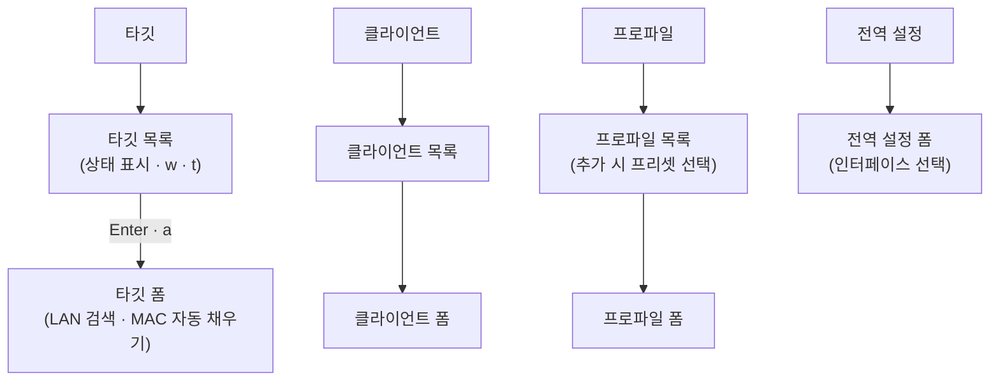

# wolproxy TUI 명세

작성일: 2026-11-24 · 수정: 2026-11-25

`wolproxy`를 인자 없이 실행하면 뜨는 설정 편집기다. 탭 4개(타깃, 클라이언트, 프로파일, 전역 설정)를 오가며 목록에서 항목을 고르고 폼으로 편집한 뒤, `s` 한 번으로 검증·저장·적용까지 한다. 기능 전반은 [기능 명세](01-기능명세.md)를 따른다.

## 화면 구성

상단 탭으로 영역을 고르고, 목록에서 `Enter`(편집)나 `a`(추가)로 폼에 들어간다.

어느 화면에서나 `s`로 저장: 검증 → 변경 요약 → 쓰기 → 적용.

## 화면별 항목

각 탭은 목록과 편집 폼으로 이루어진다. 전역 설정만 목록 없이 폼 하나다.

| 탭 | 목록 컬럼 | 폼 필드 |
| --- | --- | --- |
| 타깃 | 이름, IP(별칭), 프로파일, 상태, note | 이름, IP·MAC(LAN 검색 또는 자동 채우기), 별칭(선택), 프로파일(다중 선택), 허용 클라이언트(다중 선택), note |
| 클라이언트 | 이름, IP/CIDR, 참조 타깃 수, note | 이름, IP/CIDR, note |
| 프로파일 | 이름, 포트, wake, idle_timeout, 참조 타깃 수, note | 이름, 포트, wake(auto/never), idle_timeout, idle_bytes, note |
| 전역 설정 | — | LAN 인터페이스, 유입 인터페이스(다중 선택), proxy_port, wake_timeout, wake_cooldown, poll_interval |

- 인터페이스 필드는 직접 입력하지 않고 현재 시스템의 인터페이스 목록에서 고른다.
- 프로파일 추가 시 처음에 프리셋(rdp, ssh, 빈 프로파일)을 고르고, 그 값이 채워진 폼이 열린다.
- LAN 검색: 타깃 폼에서 LAN 서브넷 전체에 ARP 요청을 보내고, 응답한 기기를 IP·MAC·호스트 이름(역방향 DNS) 목록으로 보여 준다. 고르면 IP와 MAC이 채워지고, 이미 등록된 타깃은 표시된다.
  - 켜진 기기만 나온다. /22보다 큰 서브넷은 스캔하지 않고 직접 입력하게 한다.
  - root가 아니면 비활성된다.
- MAC 자동 채우기: IP를 직접 입력한 경우 시스템의 ARP 기록에서 MAC을 읽고, 못 찾으면 이유를 보여 준다.
- 폼은 입력 즉시 필드 단위 검사(IP·MAC 형식, 포트 범위)를 하고, 설정 전체 검증은 저장 때 한다.

## 키 조작

화면 하단에 현재 화면에서 쓸 수 있는 키를 항상 표시한다.

| 키 | 동작 | 어디서 |
| --- | --- | --- |
| `Tab` / `Shift+Tab` | 다음·이전 탭 (폼에서는 다음·이전 필드) | 전체 |
| `↑` `↓` / `j` `k` | 항목 이동 | 목록 |
| `Enter` | 편집 폼 열기 | 목록 |
| `a` | 추가 | 목록 |
| `d` | 삭제 (확인 후) | 목록 |
| `w` | 매직 패킷 송신 | 타깃 목록 |
| `t` | 포트 열림 테스트 | 타깃 목록 |
| `Ctrl+L` | LAN 검색 | 타깃 폼 |
| `Esc` | 폼 취소 (변경 버림) | 폼 |
| `s` / `Ctrl+S` | 저장·적용 (폼 안에서는 `Ctrl+S`) | 전체 |
| `q` | 종료 (저장 안 한 변경이 있으면 확인) | 전체 |
| `?` | 도움말 | 전체 |

폼의 편집 내용은 폼을 닫을 때 메모리의 설정에 반영되고, 파일에는 `s`를 누를 때만 쓴다. 폼 안에서는 `s`가 글자로 입력되므로, `Ctrl+S`로 폼 내용을 반영하고 바로 저장한다.

## 저장과 적용

`s`를 누르면 아래 순서로 진행하고, 어느 단계에서든 실패하면 멈춘 뒤 이유를 보여 준다.

1. 검증: 데몬과 같은 검증 함수를 돌린다. 오류가 있으면 목록으로 보여 주고, 고르면 해당 항목의 폼으로 이동한다. 설정한 인터페이스가 시스템에 없으면 경고로만 보여 주고 저장은 막지 않는다.
2. 변경 요약: 추가·수정·삭제된 항목을 보여 주고 확인을 받는다. 파일에 머리말 밖 주석이 있었다면 주석이 사라진다는 경고도 함께 보여 준다.
3. 쓰기: 이전 파일을 `config.yaml.bak`으로 백업하고, 머리말을 넣어 임시 파일에 쓴 뒤 rename한다. 다른 곳에서 파일이 바뀌었으면(TUI를 연 뒤 수정 시각 변경) 덮어쓰기 전에 확인한다.
4. 적용: `systemctl reload wolproxy`로 재적재하고, 데몬이 꺼져 있으면 시작한다. 실행 중 설정과 비교해 `proxy_port`·유입 인터페이스·LAN 인터페이스가 바뀌었으면 "재시작하면 프록시 연결이 끊긴다"는 확인을 받고 `systemctl restart wolproxy`를 실행한다. 실패하면 journald 마지막 몇 줄을 보여 준다.

root가 아니면 읽기 전용으로 열리고, `s`는 "저장하려면 sudo로 실행" 안내만 띄운다.

## 상태 표시와 삭제 규칙

타깃 상태는 TUI가 직접 확인하고, 다른 항목이 참조하는 것은 지울 수 없다.

- 상태 표시: 타깃 탭에 있을 때 10초마다 ARP 응답으로 "깨어 있음/잠듦"을 표시한다. 타깃 포트에는 주기적으로 접속하지 않는다. 읽기 전용으로 열려도 표시한다.
- 포트 확인: `t`를 누르면 그 타깃의 프로파일 포트에 직접 접속해 본다. 프로파일이 없는 타깃에서는 비활성된다.
- 깨우는 중: `w` 후에는 깨어남이 확인되거나 `wake_timeout`이 지날 때까지 "깨우는 중"으로 표시한다.
- 삭제: 타깃이 참조하는 클라이언트나 프로파일은 삭제를 막고, 어느 타깃이 쓰는지 보여 준다.
- 이름 변경: 클라이언트나 프로파일 이름을 바꾸면 그것을 참조하는 타깃에도 함께 반영한다.

## 구현 고려사항

- 구현: Bubble Tea + huh.
- LAN 검색: raw ARP로 보내므로 CAP_NET_RAW가 필요하다. 커널 이웃 테이블을 쓰는 방식은 권한이 필요 없지만 느리고 덜 정확하다.
- 상태 표시: 주기적인 TCP 확인은 타깃의 sshd·RDP 로그에 연결 기록을 남기므로 ARP를 쓴다. NIC의 ARP 오프로드가 켜져 있으면 잠든 PC가 깨어 있는 것으로 보일 수 있다. root가 아니면 커널 이웃 테이블만 읽으므로 상태가 최대 약 30초 늦게 바뀔 수 있다.
